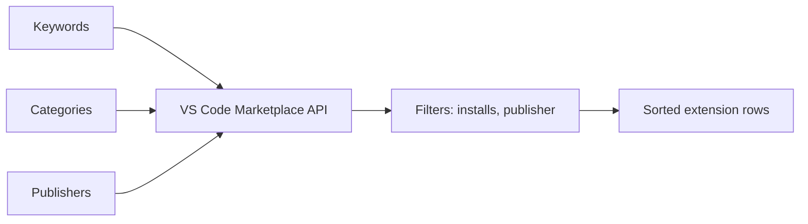

# VS Code Extensions Scraper: Installs, Ratings and Publishers

[](https://apify.com/Turboextract/vscode-extensions)
[](LICENSE)
[](#pricing)

**Export Visual Studio Code Marketplace extensions by keyword, category or publisher, with installs, rating, review count, trending score, version, categories, tags, pricing, GitHub repo and publish dates.** Track developer tool trends or build a list of extension makers. No API key.

In one test, the 50 most installed extensions came back in 6 seconds. Together they have 3.06 billion installs from 24 publishers, and 48 of them link a source repo.

**Try it now →** [apify.com/Turboextract/vscode-extensions](https://apify.com/Turboextract/vscode-extensions)

---

## Why this exists

- The VS Code Marketplace has no export for extensions or stats.
- Installs, ratings and trending scores are spread across pages.
- Publisher domains and GitHub repos sit in extension metadata.
- Dev tool teams need a category in one sheet to size a market.

---

## Who this is for

- **Dev tool founders** sizing a category before building an extension
- **DevRel and marketing teams** tracking competitors' installs and ratings
- **Sales teams** finding companies that ship VS Code extensions
- **Investors and analysts** spotting fast-growing developer tools
- **Researchers** studying the VS Code ecosystem

---

## What you get

```json
{
  "extensionId": "ms-python.vscode-pylance",
  "name": "Pylance",
  "url": "https://marketplace.visualstudio.com/items?itemName=ms-python.vscode-pylance",
  "shortDescription": "A performant, feature-rich language server for Python in VS Code",
  "publisherId": "ms-python",
  "publisherName": "Microsoft",
  "publisherVerified": true,
  "publisherDomain": "https://microsoft.com",
  "installs": 213511809,
  "averageRating": 2.95,
  "ratingCount": 286,
  "trendingWeekly": 0.34,
  "version": "2026.4.101",
  "pricing": "Free",
  "categories": [
    "Programming Languages"
  ],
  "tags": [
    "json",
    "python"
  ],
  "repository": "https://github.com/microsoft/pylance-release",
  "publishedDate": "2020-06-30",
  "lastUpdated": "2026-10-16"
}
```

The sample is shortened (tags cut to 5). Each run reads live values.

---

## How it works



---

## Quick start

1. Click **Try for free**.
2. Add **Search keywords**, like `python` or `ai agent`, or **Categories**, like `AI` or `Themes`.
3. Pick **Sort**: Most installs, Best rated, Trending this week, Newest or Recently updated.
4. Optional: set **Minimum installs**.
5. Click **Start**, then export to CSV, JSON, Excel or Google Sheets.

### API

```bash
curl -X POST "https://api.apify.com/v2/acts/Turboextract~vscode-extensions/run-sync-get-dataset-items?token=YOUR_TOKEN" \
  -H "Content-Type: application/json" \
  -d '{"categories": ["AI"], "sort": "trending", "maxResults": 100}'
```

### Python

```python
from apify_client import ApifyClient

client = ApifyClient("YOUR_TOKEN")
run = client.actor("Turboextract/vscode-extensions").call(run_input={"searchQueries": ["tailwind"], "maxResults": 50})
for row in client.dataset(run["defaultDatasetId"]).iterate_items():
    print(row["name"], row["installs"], row["averageRating"])
```

---

## Input fields

| Field | Default | What it does |
|---|---|---|
| `searchQueries` | – | Words to search extensions |
| `categories` | – | Marketplace categories |
| `publishers` | – | Only these publisher IDs |
| `sort` | installs | Installs, rating, trending, newest, updated |
| `minInstalls` | 0 | Install floor |
| `maxResults` | 50 | Total cap per run |

---

## Pricing

**$0.0005 per extension delivered.** 1,000 extensions cost $0.50.

| Option | 1,000 extensions |
|---|---|
| **VS Code Extensions Scraper** | **$0.50** |
| Manual research | Hours of copying |

---

## Common use cases

- **Market sizing**: installs and ratings for every extension in a category
- **Competitor tracking**: weekly installs and rating changes for rival extensions
- **Trend spotting**: what is trending this week in AI, chat or testing
- **Lead lists**: verified publishers with their domain and GitHub repo
- **Newest tools**: freshly published extensions for a newsletter

---

## Tips for best results

- Category names match the Marketplace, like `AI`, `Chat`, `Linters`, `Formatters`, `Snippets` or `Programming Languages`.
- Publisher IDs are the part before the dot in an extension ID, like `ms-python` in `ms-python.python`.
- `trendingWeekly` is the Marketplace's own growth score; higher means faster growth.
- Schedule daily runs to build your own install history.

---

## Pairs well with

- [Chrome Extension Leads](https://apify.com/Turboextract/chrome-extension-leads): Chrome Web Store extensions and developers
- [Firefox Add-ons Scraper](https://apify.com/Turboextract/firefox-addons): Firefox extensions with users and ratings
- [npm Packages Scraper](https://apify.com/Turboextract/npm-packages): JavaScript packages with downloads

---

## FAQ

**Do I need a key?** No. The actor uses the Marketplace's public gallery API.

**Does it cover Open VSX?** No, only the Microsoft Visual Studio Code Marketplace.

**Are installs exact?** They are the Marketplace's own counters, read live.

**Why are some ratings empty?** The extension has no reviews yet.

**Is it legal?** It reads public listing data. Respect the Marketplace terms when you publish it.

---

## SEO keywords

VS Code extensions scraper, VS Code Marketplace API export, Visual Studio Code extension data, extension installs tracker, VS Code extension list CSV, developer tool market research, extension publisher leads, top VS Code extensions, trending VS Code extensions

---

## Support

- Actor page: https://apify.com/Turboextract/vscode-extensions
- Issues and questions: open an issue in this repo
- Community Discord: https://discord.gg/8SrXSCpvgj

Built and maintained by [Turboextract](https://apify.com/Turboextract) on the Apify platform.

---

## License

The documentation and examples in this repository are MIT licensed. The actor itself runs on the Apify platform.
